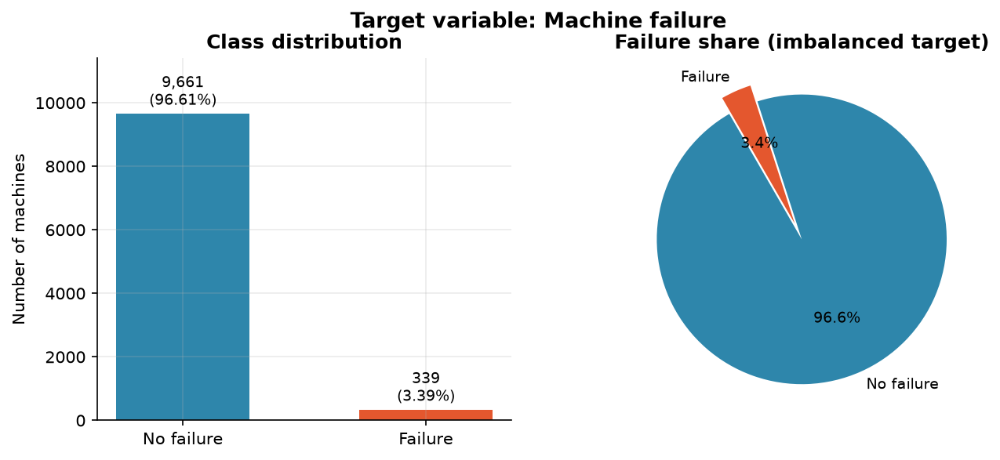
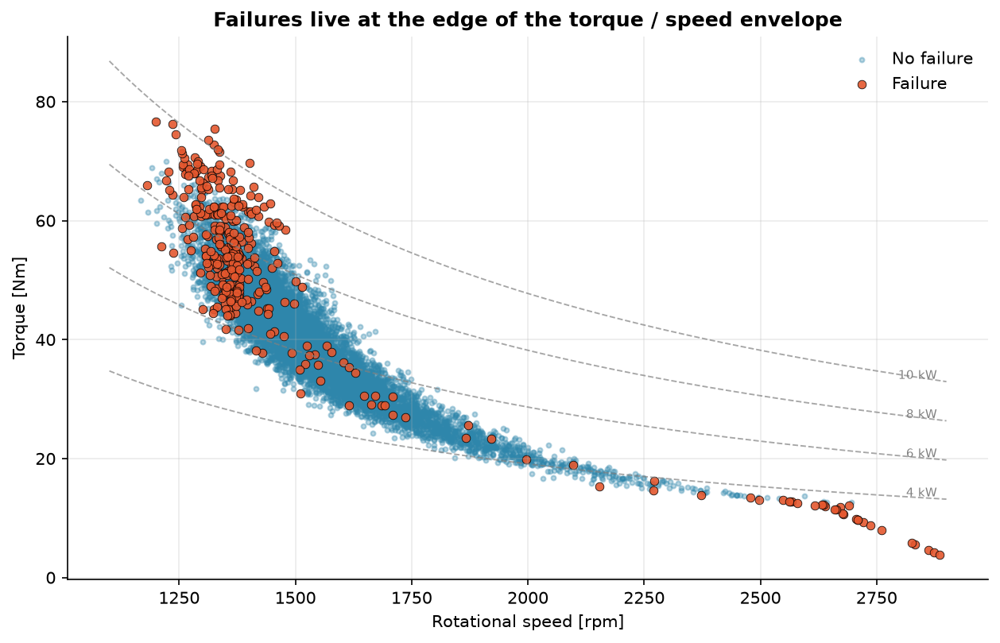
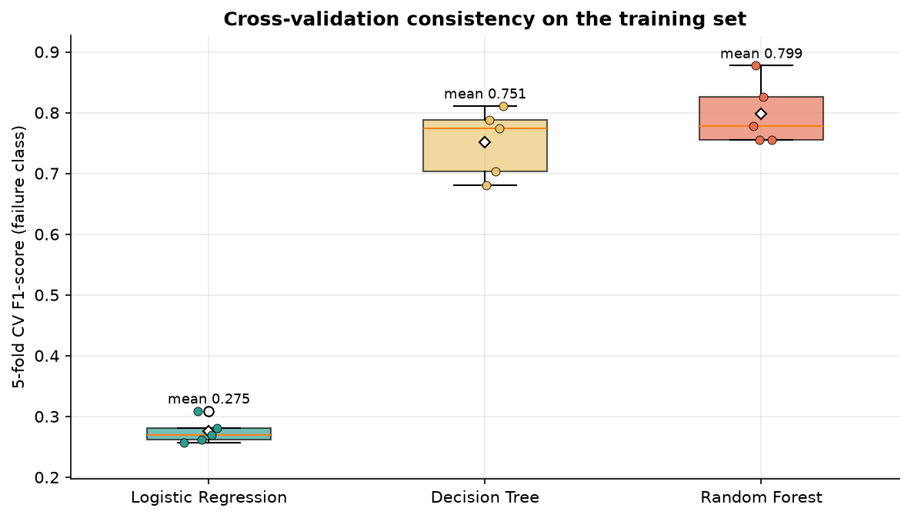
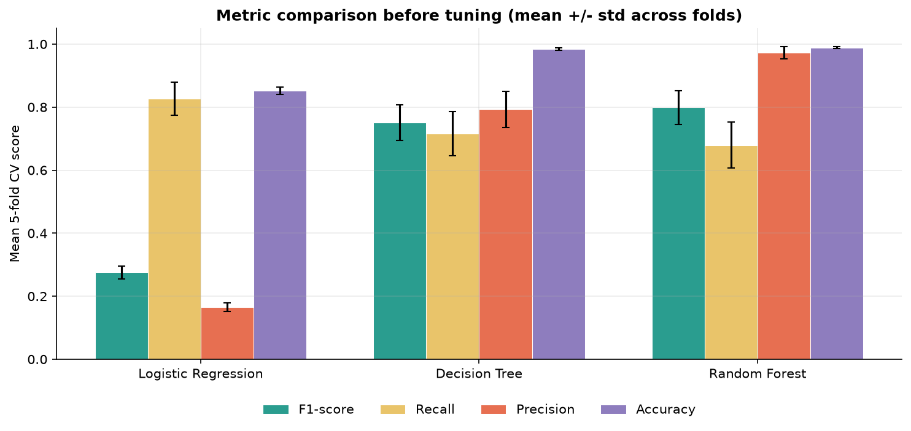
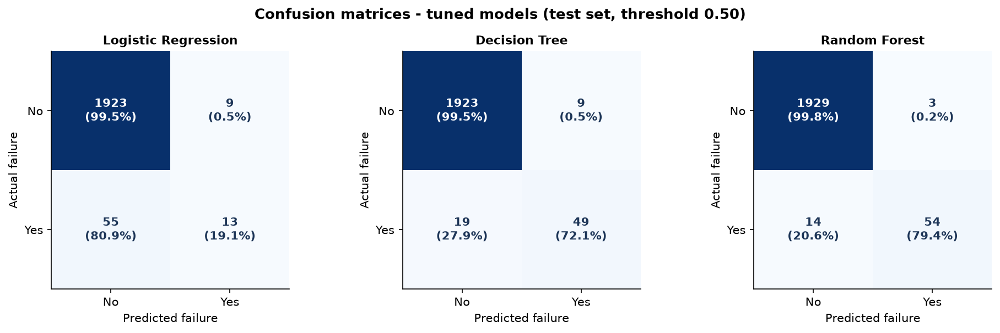
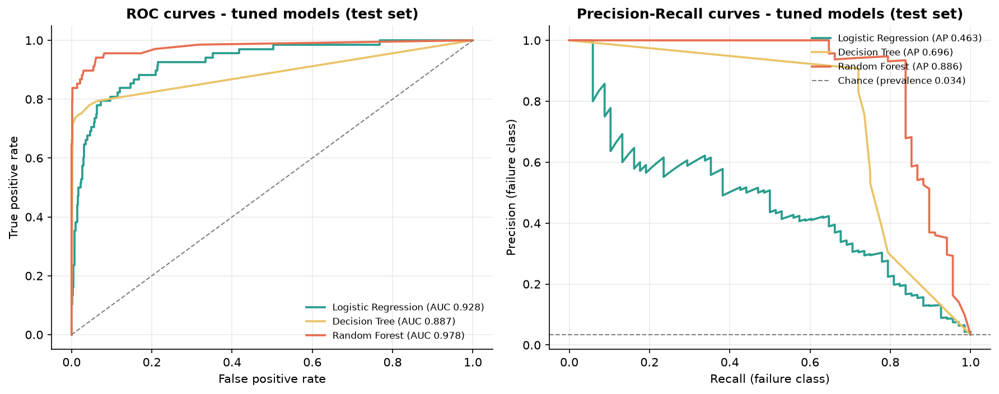
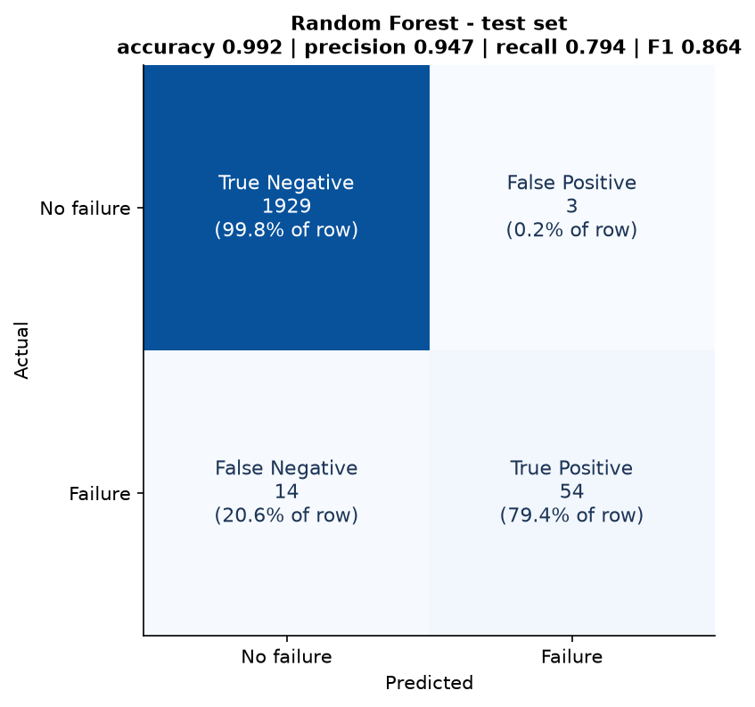
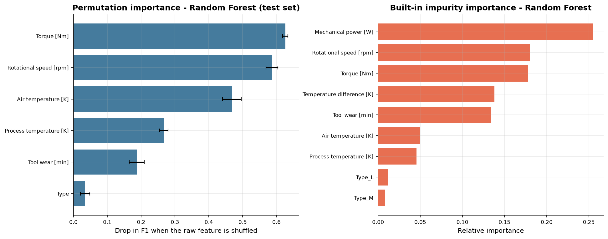
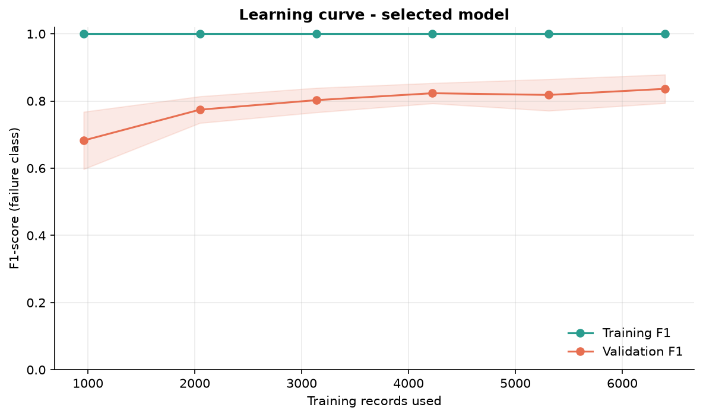

# Industrial Machine Failure Prediction

**Dataset:** AI4I 2020 Predictive Maintenance (UCI) - 10,000 records, 14 columns
**Task:** binary classification of `Machine failure` (Yes / No)
**Selected model:** **Random Forest** (`class_weight=None, max_depth=None, max_features=sqrt, min_samples_leaf=1, n_estimators=400`)
**Trained:** 27 November 2026, 16:28 | scikit-learn 1.9.1

---

## 1. Dataset understanding

The AI4I dataset simulates 10,000 industrial machines described by a quality grade
(`Type`: L/M/H), three thermal/kinematic sensor families
(air temperature, process temperature, rotational speed, torque) and accumulated
`Tool wear`. 339 machines failed (3.39%), so this is a strongly imbalanced
binary classification problem.

| Column | Role |
|---|---|
| `UDI`, `Product ID` | row identifiers - removed |
| `Type` | categorical input (one-hot encoded) |
| `Air temperature [K]`, `Process temperature [K]`, `Rotational speed [rpm]`, `Torque [Nm]`, `Tool wear [min]` | numeric inputs |
| `Machine failure` | target |
| `TWF`, `HDF`, `PWF`, `OSF`, `RNF` | failure-mode flags describing *why* the machine failed - removed to prevent leakage |

## 2. Exploratory data analysis

No missing values, no duplicate rows, all 10,000 records usable.
The target is imbalanced (96.61% healthy / 3.39% failure), which makes
**accuracy a misleading metric**: a model that always says "No" already scores 96.6%.

Key findings (see `reports/figures/01`-`09`):

- Failing machines show **higher torque, higher tool wear and lower rotational
  speed** than healthy machines; air temperature is slightly higher.
- Failures cluster at the boundary of the torque/speed envelope, i.e. at high
  mechanical power (`06_torque_rpm_power.png`).
- `Type` matters mildly: failure rates differ across L/M/H, and low-quality
  machines dominate the fleet.
- The five failure-mode flags are near-perfect predictors of the target because
  they *compose* it (a simple OR of the flags reproduces `Machine failure` for
  99.73% of rows). Including them would produce meaningless ~100% accuracy,
  so they are excluded from `X` (`04_correlation_heatmap.png`, right panel).

Descriptive tables: `reports/metrics/eda_*.csv`.

## 3. Data preparation

- Removed `UDI`, `Product ID` (identifiers) and `TWF`, `HDF`, `PWF`, `OSF`, `RNF`
  (target-derived leakage).
- Missing values: none; the pipeline nevertheless contains median / most-frequent
  imputers so it is safe on new data.
- Encoded `Type` with one-hot encoding (`L` is the reference category).
- Added two physically motivated features (no leakage, inputs only):
  - `Temperature difference [K] = process - air`
  - `Mechanical power [W] = torque * 2*pi*rpm / 60`
- Scaled numeric features with `StandardScaler` for Logistic Regression
  (harmless for trees).
- All preprocessing lives in a scikit-learn `Pipeline`, so the exact same
  transformations are applied at prediction time.

Final feature space: **9 columns** after encoding.

## 4. Train / test split

Stratified 80/20 split,
`random_state=42`:

| Set | Records | Failures | Prevalence |
|---|---|---|---|
| Training | 8,000 | 271 | 3.39% |
| Test | 2,000 | 68 | 3.40% |

The test set is not used for fitting or model selection; it is only used for the
comparison tables and the final evaluation reported here.

## 5-6. Baseline models and comparison

Logistic Regression, Decision Tree and Random Forest were trained with
class-imbalance-aware settings (balanced class weights). Full metric table on the
test set (threshold 0.50):

| Model | Accuracy | Precision | Recall | F1-score | ROC-AUC | PR-AUC |
|---|---|---|---|---|---|---|
| Logistic Regression | 0.858 | 0.177 | 0.868 | 0.294 | 0.934 | 0.467 |
| Decision Tree | 0.984 | 0.814 | 0.706 | 0.756 | 0.850 | 0.584 |
| Random Forest | 0.988 | 0.940 | 0.691 | 0.797 | 0.965 | 0.856 |

Accuracy looks excellent for the tree models, but on a 96.6% healthy dataset a
constant "No failure" prediction already scores 96.6%, so precision, recall and
F1 for the failure class are the metrics that matter.

## 7. 5-fold cross-validation

Stratified 5-fold CV was run on the training data only, so the test set stays
untouched (per-fold scores in `reports/metrics/cv_baseline_folds.csv`):

| Model | CV F1 (mean) | Std | CV recall | CV precision | CV accuracy |
|---|---|---|---|---|---|
| Logistic Regression | 0.276 | 0.021 | 0.827 | 0.165 | 0.852 |
| Decision Tree | 0.751 | 0.056 | 0.716 | 0.793 | 0.984 |
| Random Forest | 0.798 | 0.053 | 0.679 | 0.973 | 0.988 |

Random Forest has the highest mean CV F1 (0.798).
The Decision Tree is close but less consistent across folds, the expected
signature of a single high-variance tree. Logistic Regression is the most stable
model but also the weakest: class weighting gives it high recall at very low
precision, so its F1 stays around 0.28.

## 8. Hyperparameter tuning

`GridSearchCV` with the same stratified 5-fold split, optimising **F1 of the
failure class** (a sensible choice under 3.4% prevalence).

| Model | Best CV F1 | Std | CV recall | Best hyperparameters | Combinations | Seconds |
|---|---|---|---|---|---|---|
| Logistic Regression | 0.410 | 0.049 | 0.284 | `{'C': 10.0, 'class_weight': None}` | 10 | 0.510 |
| Decision Tree | 0.818 | 0.050 | 0.775 | `{'class_weight': None, 'criterion': 'entropy', 'max_depth': 10, 'min_samples_leaf': 1}` | 96 | 4.170 |
| Random Forest | 0.836 | 0.044 | 0.735 | `{'class_weight': None, 'max_depth': None, 'max_features': 'sqrt', 'min_samples_leaf': 1, 'n_estimators': 400}` | 36 | 45.960 |

The complete grids are stored in `reports/metrics/grid_*.csv`; the tuning table
with all metrics is `reports/metrics/tuning_results.csv`.

Note that tuning maximises F1 at a fixed 0.50 threshold, not recall. For
Logistic Regression the grid preferred an unweighted model that is more precise
but misses most failures, which is why its recall falls compared with the
balanced baseline. This shows why the metric and the operating point have to be
chosen together.

## 9. Model selection and final evaluation

Model selection is based on **cross-validated F1** (tie-break: CV recall), not on
the test set. Selected: **Random Forest**.

All three tuned models on the untouched test set:

| Model | Accuracy | Precision | Recall | F1-score | ROC-AUC | PR-AUC |
|---|---|---|---|---|---|---|
| Logistic Regression | 0.968 | 0.591 | 0.191 | 0.289 | 0.928 | 0.463 |
| Decision Tree | 0.986 | 0.845 | 0.721 | 0.778 | 0.887 | 0.696 |
| Random Forest | 0.992 | 0.947 | 0.794 | 0.864 | 0.978 | 0.886 |

### Final test metrics

| Metric | Value |
|---|---|
| Accuracy | 0.9915 |
| Precision (failure) | 0.9474 |
| Recall (failure) | 0.7941 |
| F1-score (failure) | 0.8640 |
| ROC-AUC | 0.9783 |
| PR-AUC | 0.8856 |

### Confusion matrix (test set, threshold 0.50)

|  | Predicted No | Predicted Yes |
|---|---|---|
| Actual No | 1929 | 3 |
| Actual Yes | 14 | 54 |

- Caught **54 of 68** failures
  (recall 79.4%).
- **3** false alarms out of 1932 healthy machines
  (false-positive rate 0.2%).
- Missed failures (14) are the expensive error for maintenance planning,
  which is why F1 (which balances recall against false alarms) was optimised.

### Operating point

Out-of-fold predictions show that the F1-optimal threshold is
**0.45** (F1 0.846 on training).
For reference, applying it to the test set gives
precision 0.931 / recall 0.794 / F1 0.857
versus 0.947 / 0.794 / 0.864 at 0.50.
The deployed system keeps 0.50 so that predicted probabilities stay directly
interpretable; `15_threshold_analysis.png` documents the trade-off.

### What drives the prediction

| Feature | Permutation importance (drop in test F1) |
|---|---|
| Torque [Nm] | 0.626 |
| Rotational speed [rpm] | 0.587 |
| Air temperature [K] | 0.468 |
| Process temperature [K] | 0.267 |
| Tool wear [min] | 0.187 |
| Type | 0.034 |

The model's internal (impurity) importance concentrates on the derived
**mechanical power**, then rotational speed and torque. Permutation importance
spreads the credit differently because power is a deterministic function of
torque and speed, so shuffling any one of them damages a signal the tree can
partly rebuild from the others. Both views agree with the EDA: power, torque,
speed and tool wear are the physical drivers of failure in this dataset, while
`Type` contributes little.

The learning curve flattens as training size grows, so extra data of the same
kind would bring only modest F1 gains.

## 10-11. Prediction interface and saved artifacts

- `models/machine_failure_model.joblib` - complete pipeline (engineering +
  encoding + scaling + classifier) and metadata.
- `models/model_card.json` - machine-readable model card.
- `python main.py predict` - interactive command-line interface.
- `python main.py predict --air 298.1 --process 308.6 --rpm 1550 --torque 42.8 --wear 0 --type L --explain`
- `streamlit run app.py` - web form.

The prediction path loads the artifact, validates inputs against the training
ranges, and returns `Machine Failure: Yes/No` plus the estimated probability.

## Limitations

- AI4I is synthetic: failure modes are generated from threshold rules plus
  random failures, so real plant data would be noisier.
- 339 positive cases limit how precise the performance estimates are; CV std
  and the confidence of the test metrics should be read together.
- Random failures (RNF) are unpredictable by construction and cap achievable recall.
- The model predicts *risk from current operating conditions*, not remaining
  useful life.
